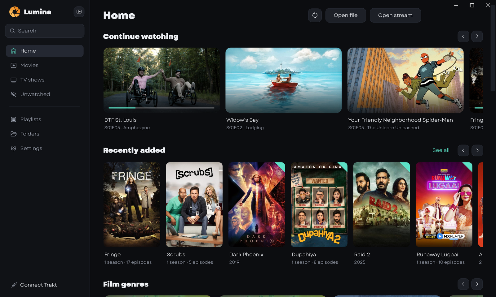
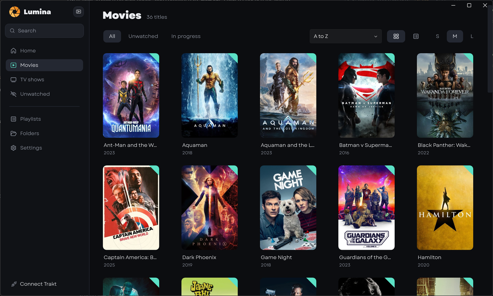
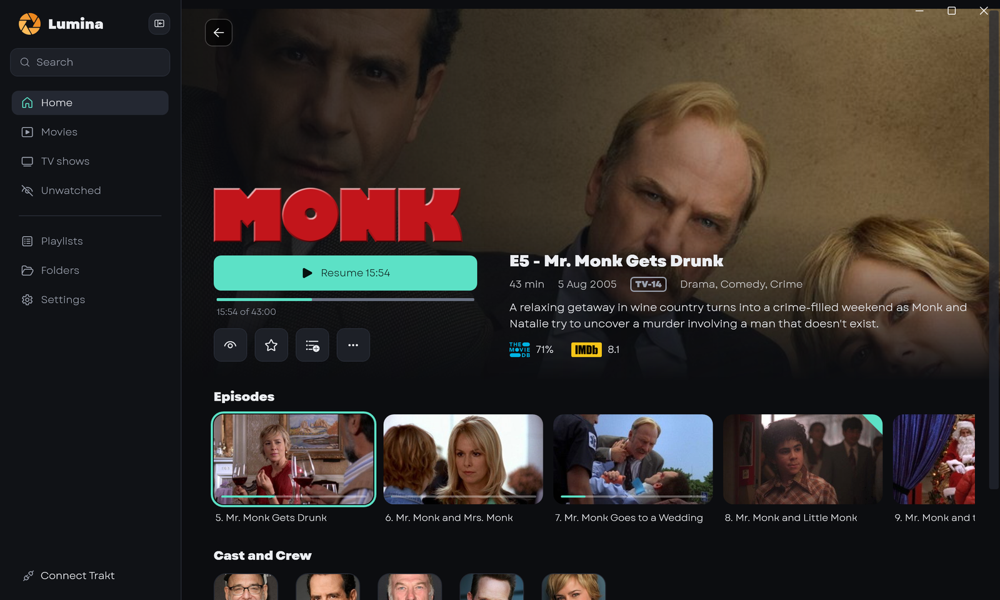
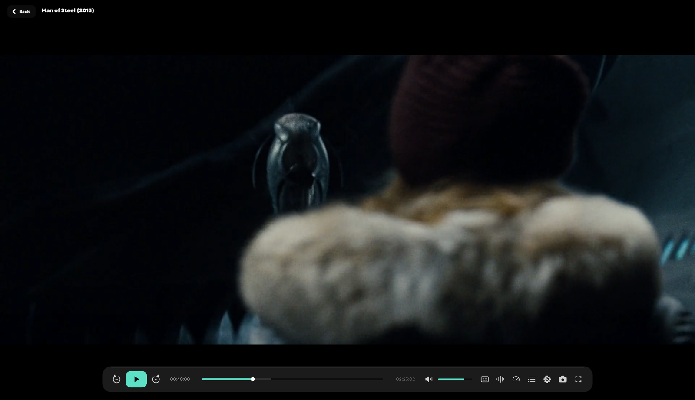
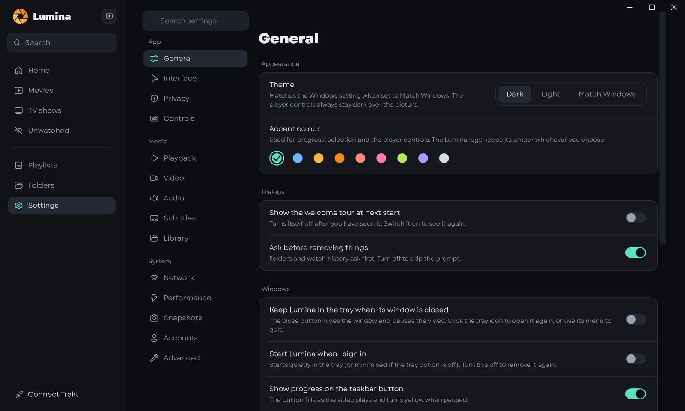

<p align="center">
  
</p>

<h1 align="center">Lumina</h1>

<p align="center"><strong>Your media, in the light.</strong><br/>
A modern media library and video player for Windows. Point it at your folders, get a beautiful library with posters, summaries and cast, and play anything with a fast, VLC-grade engine.</p>

<p align="center">
  <a href="https://github.com/nomoron28/lumina/releases/latest"></a>
  <a href="LICENSE"></a>
  
  
  <a href="https://buymeacoffee.com/nomoron28"></a>
</p>

<p align="center"></p>

## Why Lumina

Most players are either a bare video window or a heavy media server. Lumina is a desktop app that is both: a library that makes your files look like a streaming service, and a player that opens everything.

- **A library that reads your folders and nothing else.** Lumina scans local folders and network shares, matches titles, and fills in posters, summaries, cast, ratings and episode stills. Files are never moved, renamed or uploaded.
- **A player built on libmpv.** Hardware decoding, HDR, high-resolution audio, every codec you are likely to meet, and smooth playback on modest graphics hardware.
- **A controller designed for the picture.** A slim glass bar that gets out of the way, with drag-to-scrub, touch support, and notes you can read at a glance.
- **Yours to change.** About 100 settings, nine accent colours, dark, light or follow Windows, profiles, and every keyboard shortcut can be rebound.
- **Private by default.** No account, no telemetry. Trakt, OpenSubtitles and TMDB are optional and use your own keys.

## Screenshots

| | |
|---|---|
|  |  |
| **Library.** Posters, an unwatched marker, sort and filter. | **Details.** Title art, resume with progress, episodes, cast, ratings. |
|  |  |
| **Player.** One slim bar: transport left, seek bar in the middle, volume and tools right. | **Settings.** Searchable, grouped, nine accent colours. |

## Features

**Library**
- Folders and network shares, rescanned when they change; movies and TV shows told apart from file names.
- Posters, backdrops, title logos, summaries, genres, certificates, cast and crew from [TMDB](https://www.themoviedb.org/); IMDb and Rotten Tomatoes scores through [OMDb](https://www.omdbapi.com/).
- Continue watching, recently added, unwatched, top rated, genres, favourites, playlists.
- Fix a wrong match: right-click a title, **Edit metadata**, and pick the right one from a list.
- Per-folder PIN lock, watched marks, bookmarks, and resume points.
- Optional two-way sync of watched status with [Trakt](https://trakt.tv/).

**Player**
- libmpv engine with hardware decoding (zero-copy Direct3D 11, with a fallback), HDR to SDR tone mapping, and bit-perfect high-resolution audio (WASAPI exclusive).
- Subtitles from the file, from sidecar files, or from [OpenSubtitles](https://www.opensubtitles.com/) with a list of matches to choose from; size, position and delay remembered per video.
- Audio and subtitle track pickers, chapters, A-B loop, speed from 0.1x, aspect ratio and crop presets as in VLC, rotate, zoom and picture adjustments.
- Seek-bar preview thumbnails (switchable), mouse-wheel scrubbing, frame step, snapshots, recording, sleep timer and a miniplayer.
- Equaliser, compressor, spatial sound and loudness options.
- Mouse, keyboard and touch. See [docs/shortcuts.md](docs/shortcuts.md).

**Windows integration**
- Per-user installer (no administrator rights) and a portable zip; "Open with" and file associations; single instance; jump list and taskbar progress; media keys and the Now Playing overlay; tray icon and start with Windows; auto-hide taskbar reveal in fullscreen.

## Install

1. Download **`Lumina-<version>-setup.exe`** (installer) or **`Lumina-<version>-portable.zip`** from the [latest release](https://github.com/nomoron28/lumina/releases/latest).
2. Run the installer, or unzip the portable build anywhere. The portable build keeps all its data in a `data` folder beside it.
3. Start Lumina, choose a folder in the welcome screen, and you are done.

Requirements: Windows 10 version 1809 or newer, 64-bit. Nothing else needs installing; the .NET runtime is included.

> The installer is not code-signed, so Windows SmartScreen shows a warning the first time ("More info", then "Run anyway"). Check the download against `SHA256SUMS.txt` on the release page if you want to be sure.

### Getting posters, summaries and subtitles

Lumina works without any keys, but artwork and subtitles come from free services that each need a key. Add yours once in **Settings, Accounts**:

| Service | Used for | Where to get a key |
|---|---|---|
| TMDB | posters, backdrops, summaries, cast | <https://www.themoviedb.org/settings/api> |
| OMDb | IMDb and Rotten Tomatoes scores (optional) | <https://www.omdbapi.com/apikey.aspx> |
| OpenSubtitles | subtitle search (optional) | <https://www.opensubtitles.com/consumers> |
| Trakt | watched sync (optional, sign-in uses a device code) | <https://trakt.tv/oauth/applications> |

Keys are stored in `config.json` on your machine and never leave it except to call the service they belong to.

## Build from source

You need the [.NET 10 SDK](https://dotnet.microsoft.com/download) on Windows, and a `libmpv-2.dll` (x64) to run the player.

```powershell
git clone https://github.com/nomoron28/lumina.git
cd lumina
# put libmpv-2.dll in third_party\libmpv\  (see docs/development.md for where to get one)
dotnet build -c Release
dotnet run --project src/Lumina
```

Run the tests, or the full quality gate (build, design-token contrast check, tests, a real-input tour of the UI, performance budgets):

```powershell
dotnet test
powershell -File scripts\gate.ps1 -SkipUi     # everything except the part that drives your mouse
```

Build the installer and the portable zip: `powershell -File scripts\package.ps1 -NoKeys` (needs [Inno Setup 6](https://jrsoftware.org/isinfo.php)). Details, project layout and conventions are in [docs/development.md](docs/development.md) and [docs/architecture.md](docs/architecture.md).

The Garet typeface Lumina is designed around is not in the repository (its licence does not allow redistributing the font files). Without it Lumina uses Segoe UI; to get the intended look, download Garet from [Spacetype](https://spacetype.co) and put `Garet-Book.ttf` and `Garet-Heavy.ttf` in `src/Lumina/Assets/Fonts/`.

## Documentation

| | |
|---|---|
| [Getting started](docs/getting-started.md) | Install, first run, adding folders, keys |
| [User guide](docs/user-guide.md) | The library, details pages, the player, subtitles, touch |
| [Keyboard and mouse shortcuts](docs/shortcuts.md) | Every default key, and how to rebind |
| [Settings reference](docs/settings.md) | What each settings page does |
| [Troubleshooting](docs/troubleshooting.md) | Stutter, blocked services, missing posters, SmartScreen |
| [Architecture](docs/architecture.md) | How the app is put together |
| [Development](docs/development.md) | Building, testing, the gate, packaging |
| [Changelog](CHANGELOG.md) | What changed in each release |
| [Roadmap](ROADMAP.md) | What is coming in the next releases |
| [Contributing](CONTRIBUTING.md) · [Security](SECURITY.md) · [Code of conduct](CODE_OF_CONDUCT.md) | |

## Support Lumina

Lumina is free and open source, made in spare time. If it makes your movie nights better, you can [buy me a coffee](https://buymeacoffee.com/nomoron28): it buys time for fixes and features, and for testing on more hardware. Starring the repository, reporting bugs and telling a friend help just as much.

[](https://buymeacoffee.com/nomoron28)

## Code signing policy

Free code signing provided by [SignPath.io](https://about.signpath.io/), certificate by [SignPath Foundation](https://signpath.org/) (applied for; until it is approved, releases are unsigned).

- Only release builds made by this repository's [Release workflow](.github/workflows/release.yml) on GitHub Actions, from the public source on `main`, are signed. Builds made on a personal computer are never signed.
- Committers and reviewers: [nomoron28](https://github.com/nomoron28). Approver of each signing request: [nomoron28](https://github.com/nomoron28). The account uses two-factor sign-in.
- Every change reaches `main` through a pull request that must pass the `build-and-test` check.

**Privacy:** Lumina does not send any information to other networked systems unless you set it up or ask for it: TMDB and OMDb for artwork, details and ratings, OpenSubtitles when you search for subtitles, Trakt if you connect it, and, once a day at most, the release feed on GitHub to see whether there is a newer version (Settings, Advanced turns this off). There is no account, no telemetry and no crash reporting. Details are in the [FAQ](docs/troubleshooting.md#faq).

## Credits and licences

Lumina is free software under the **GNU General Public License v3.0 or later** (see [LICENSE](LICENSE)). It stands on the work of others: [mpv / libmpv](https://mpv.io/), [FFmpeg](https://ffmpeg.org/), [WPF-UI](https://github.com/lepoco/wpfui), [Microsoft.Data.Sqlite](https://learn.microsoft.com/dotnet/standard/data/sqlite/), and [Inno Setup](https://jrsoftware.org/isinfo.php). The full list, with licences, is in [THIRD-PARTY-NOTICES.md](THIRD-PARTY-NOTICES.md).

*This product uses the TMDB API but is not endorsed or certified by TMDB. Movie and TV information and images are provided by [TMDB](https://www.themoviedb.org/); ratings by [OMDb](https://www.omdbapi.com/). IMDb, Rotten Tomatoes, TMDB, Trakt, OpenSubtitles, VLC and other names and marks belong to their owners and are used only to identify those services. Lumina is not affiliated with any of them.*
